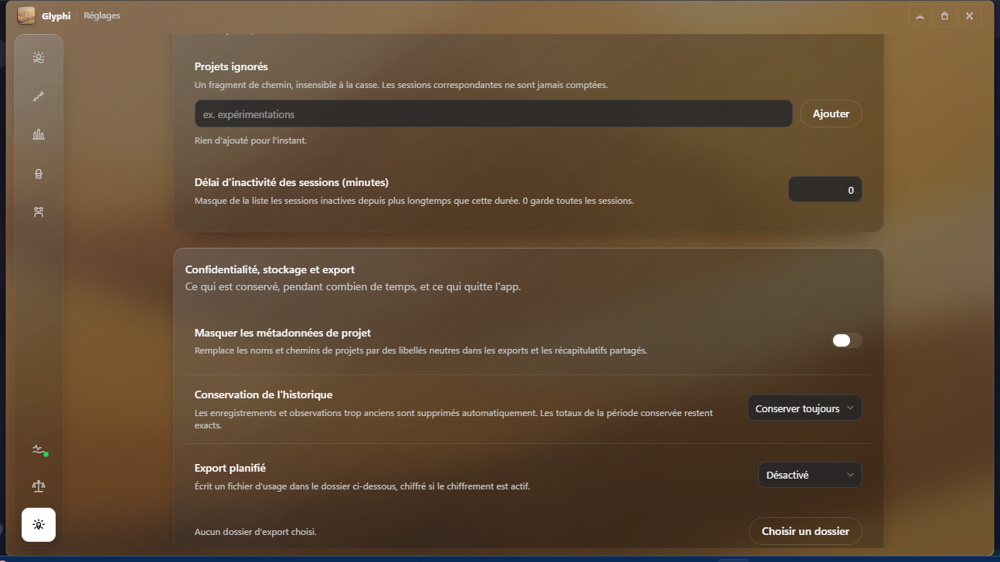

<p align="center">
  
</p>

<h1 align="center">Glyphi</h1>

<p align="center">
  Your AI coding usage, weighed on one scale.<br>
  Tokens, limits and costs for every coding tool you use — read from your own computer.
</p>

<p align="center">
  <a href="https://github.com/Artleboss2/Glyphi/releases/latest"><strong>Download Glyphi</strong></a>
  ·
  <a href="https://github.com/Artleboss2/Glyphi/releases">All releases</a>
  ·
  <a href="CONTRIBUTION.md">Contribute</a>
</p>

<p align="center">
  
  <a href="LICENSE"></a>
</p>

## What Glyphi is

Glyphi is a desktop dashboard for the AI tools a developer actually runs: coding agents, IDE
assistants, local model runtimes and hosted APIs. It reads the logs and local databases those tools
already write, adds them up per day, and shows the result in one place — the tokens you spent, the
limits you have left, and what it probably cost.

It is **local-first**. The engine parses files on your machine and makes no network request while it
scans. There is no account requirement, no proxy, no certificate to install and no browser extension.

## Highlights

- **One page for today.** Total tokens, cost estimate and a capacity meter for every tool whose
  quota it can read.
- **History that adds up.** Hourly, daily, weekly and per-model views, a heatmap, streaks and
  achievements, all computed from the same local ledger.
- **A provider directory you control.** A catalog of more than 300 AI coding tools, searchable in
  **Settings → Providers**. A scan only *suggests*; enabling a tool is always an explicit click.
- **Discovery that remembers.** Every file the scan proves is re-checked on later runs, the folders
  that held it are walked again for new ledgers, and a route that stops parsing is planned from
  scratch instead of trusted forever.
- **A real mini window.** Always-on-top, three densities, rounded glass card, left-corner placement
  and live resize.
- **An interface that is yours.** Light, dark or system theme, four type families, a type scale, ink
  and accent colours, glass or solid surfaces, motion on or off, exact figures or short units.
- **Alerts that respect you.** Quota thresholds, burn-rate warnings, reset countdowns, a daily token
  digest, Do Not Disturb and per-alert delivery rules.
- **Five languages.** English, French, Spanish, Chinese and Hindi.

## Screens



## Install

Windows, macOS and Linux builds are published from this repository, each by its own release
pipeline.

**Windows (x64)** — `Glyphi-<version> Setup.exe` (per-user install, no administrator prompt) or the
portable `Glyphi-win32-x64-<version>.zip`. The installer is not Authenticode-signed yet, so
SmartScreen may ask for **More info → Run anyway**. The in-app updater reads the Squirrel feed
published with each release.

**macOS (Apple Silicon and Intel)** — a `.dmg` and an update `.zip` per architecture. These builds are
compiled but **not signed or notarized** yet, so the first launch needs one confirmation from
Gatekeeper; if macOS still refuses, run
`xattr -dr com.apple.quarantine /Applications/Glyphi.app` once.

**Linux (x64 and arm64)** — an AppImage for a portable run, plus `.deb` and `.rpm` packages for a
system install. Linux has shipped since 0.4 and is supported alongside Windows, not as an
afterthought.

Every platform ships a `SHA256SUMS-<platform>` file with each release. Building locally uses the
same Electron Forge configuration and the commands below.

## What it reads

Glyphi reuses the sign-in a tool already has, or reads its local history. Nothing is uploaded by a
scan.

**Local history**

- **Codex** — the installed, signed-in Codex CLI through its own local app-server API.
- **Claude Code** — `CLAUDE_CODE_OAUTH_TOKEN` or the credentials file in the Claude config folder.
- **Cursor** — the local state database: account limits plus per-request token, model and cost
  history.
- **OpenCode**, **Antigravity**, **Pi / OMP**, **Muse Code**, **Kilo Code** and **Amp** — their local
  databases and JSONL sessions.
- **Freebuff** — the Desktop app's per-project database, with CLI transcripts as a fallback.
- **Gemini CLI**, **Qwen Code**, **Cline** and **Roo Code** — the token objects in their transcripts.
- **GitHub Copilot**, **Warp**, **Kimi Code**, **Factory / Droid**, **Qoder** and **z.ai / GLM** —
  current allowances and balances.

Providers that need a key or a session can be connected in **Settings → Sources**. Credentials are
encrypted with the operating system's protected storage and are excluded from every export and cloud
save.

The full list — more than 320 tools, with what is read from each — is in
[docs/PROVIDERS.md](docs/PROVIDERS.md). The exact locations, fields and limitations are documented in
[docs/LOCAL_PROVIDERS.md](docs/LOCAL_PROVIDERS.md), [QUOTA_PROVIDERS.md](docs/QUOTA_PROVIDERS.md) and
[DISCOVERY.md](docs/DISCOVERY.md).

## Privacy

Your usage stays on your computer. Glyphi reads token accounting, model names, timestamps and quota
snapshots; it does not read prompts, completions, source code or clipboard contents. Anonymous
product analytics can be turned off in Settings, and cloud save is optional.

The full policy, including what an optional cloud save contains, is in [PRIVACY.md](PRIVACY.md).

## Storage

The local database lives in the user data folder (`%APPDATA%\Glyphi` on Windows,
`~/Library/Application Support/Glyphi` on macOS, `~/.config/Glyphi` on Linux). One record per provider
and local day is the source of truth; the upload outbox keeps only what the cloud has not
acknowledged.

[STATISTICS_STORAGE.md](docs/STATISTICS_STORAGE.md) documents the tables, the compaction pass and the
recovery rules.

## Build from source

Requirements: **Bun 1.3.14** and **Node.js 22.13+**.

```bash
git clone https://github.com/Artleboss2/Glyphi.git
cd Glyphi
bun install
bun run desktop:start
```

Useful scripts:

```bash
bun run check          # tooling tests, lint, typecheck, unit tests and the renderer build
bun run desktop:make   # installers for the current platform
bun run desktop:make -- --platform=win32 --arch=x64 --targets squirrel zip
bun run generate:desktop-icons   # rebuild every icon and app mark from branding/glyphi-primary.png
```

The workspace is a Bun + Turborepo monorepo: `apps/desktop` is the Electron app, `packages/contracts`
holds the shared schemas, `tooling` the build helpers, and `docs` the storage and provider references.

## Roadmap

**0.4.x — the truth of the usage.** Native local readers, a compact history schema, a settings screen
for every option, working updates, bill-shaped cost estimates, a provider directory, an honest
attribution wheel, light and dark themes, and an icon that survives an update.

**0.5.0 — the single source of truth.** Ten hard outcomes, each marked shipped only when its
acceptance test passes in a published build:

1. **Any tool, in 30 seconds** — 300+ verified readers, 98 % detection on a clean profile, first token
   under 30 seconds, zero network requests during discovery.
2. **Bill-exact, to the cent** — within ±1 % of ten real invoices over six months across eight
   providers.
3. **Five years, three devices** — additive, conflict-free records restored in under five seconds.
4. **Invisible under load** — under 120 ms cold first paint, under 50 MB resident, under 0.05 % idle
   CPU.
5. **Five million facts, still instant** — filtered in under 80 ms with zero-loss export.
6. **Trusted by construction** — signed installers, an encrypted vault, one-launch rollback, an SBOM
   per release.
7. **Fluent for everyone** — fifteen languages, keyboard-only navigation, WCAG 2.2 AA.
8. **Predict before you spend** — a 30-day forecast within 5 %, budget guardrails and runaway-loop
   alerts.
9. **Any model, any price** — 500+ models, tiers, cache and batch rates, local models.
10. **Own every byte** — full-fidelity export, a documented local read API, a reader SDK, and a
    genuinely offline mode.

The detailed plan and current status live in [CHANGELOG.md](CHANGELOG.md) and the
[timeline](docs/timeline-0.4-0.5.svg).

## Contributing

Issues and pull requests are welcome. Read [CONTRIBUTION.md](CONTRIBUTION.md) first; for a security
problem use [SECURITY.md](SECURITY.md) instead of a public issue.

## License

Source code is available under the [PolyForm Noncommercial License 1.0.0](LICENSE). Commercial use
requires a separate agreement with the licensor. The Glyphi name and the Eye of Horus tile identify
this project and are not granted for use by a modified build.

## Disclaimer

Glyphi is an independent project. It is not affiliated with any provider whose name appears in the
app, and its figures are estimates rather than bills. See [DISCLAIMER.md](DISCLAIMER.md).
